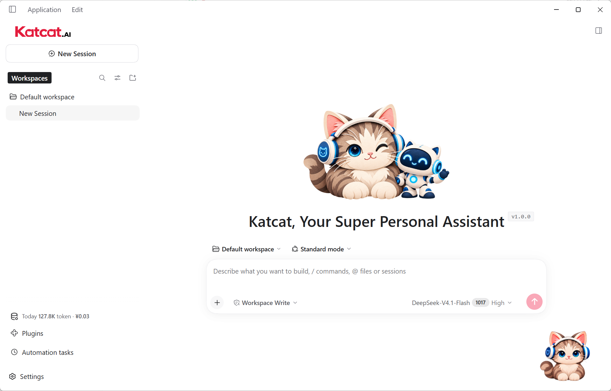
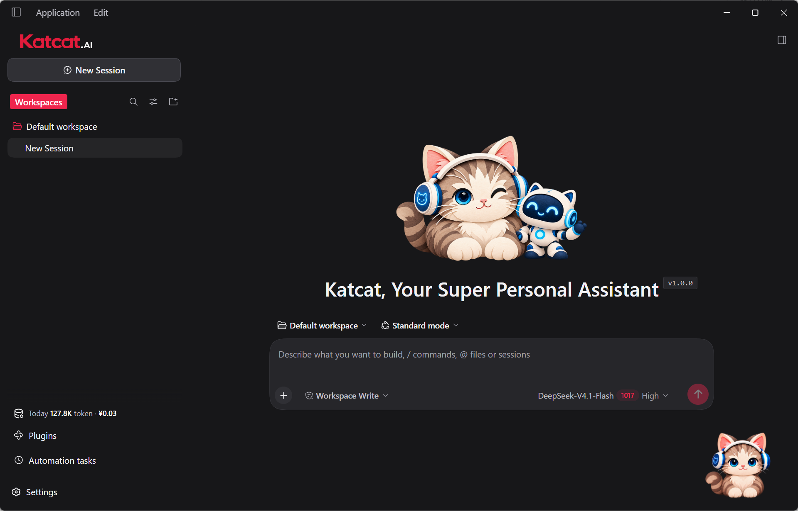

# Katcat.AI

English | [中文](README.zh.md)

**Your personal AI assistant, at home on your desktop.**

Katcat.AI is a Windows desktop agent built on **DeepSeek Harness (DSH-0.2.1-rc.2)**. It brings document processing, spreadsheet analysis, visualization, content creation, remote connections, and automation into a desktop interface, with a cat companion to keep you company.

[Download for Windows](https://www.sudotech.ai/katcat.html) · [User guide](https://www.sudotech.ai/katcat-guide.html) · [Report a bug](https://github.com/yyshi801207-sketch/Katcat.AI/issues/new/choose) · [Contribute](CONTRIBUTING.md)



## What you can do

- **Work with your materials:** read documents, organize information, analyze spreadsheets, and draft reports.
- **Turn ideas into deliverables:** explore a topic, write content, or create a visualization from your data.
- **Connect tasks:** use Harness tools and Katcat's office extensions for browser interaction, remote connections, and multi-step work.
- **Make it yours:** choose a light or dark interface, organize projects in Katcat Home, and enable the desktop cat.

Katcat adds an office-oriented product layer to DSH. Results depend on the model, tools, permissions, and task; this repository does not claim a benchmarked advantage over other agents. See the [product subsystem](docs/subsystems/xiaojing.md) for extension details.

## Run

### Install the desktop application

1. Download the Windows x64 installer from the [product page](https://www.sudotech.ai/katcat.html), currently for Windows 10 / 11.
2. Install and open Katcat.AI. On first use, select **Start using** to open API key configuration, or choose to configure it later.
3. Sign in to the [DeepSeek platform](https://platform.deepseek.com/) and create a key on the [API keys page](https://platform.deepseek.com/api_keys).
4. Save your key in Katcat. If you skipped onboarding, open **Settings → Models** to configure it.
5. Select a workspace and a configured model, then describe what you want to do.

The application is shared for free; model API usage is billed separately by the provider. Keep your API key private. Follow the illustrated [setup guide](https://www.sudotech.ai/katcat-guide.html) for the complete walkthrough.

### Try a task

> Read the documents in this workspace, summarize the main points, and draft an outline for a presentation. Ask me before modifying the original files.

> Analyze this spreadsheet, explain the changes over time, and create a chart with your findings.

> Help me turn this idea into a concrete plan. Start by identifying what information you need from me.

<a id="run-from-source"></a>

### Run from source

Use Node.js 24 and the pnpm version pinned in `package.json`. The [development guide](docs/development.md) and [native build guide](native/README.md) describe platform toolchains and supported Node versions. Live AI tasks need a model key; keyless tests do not.

```sh
git clone https://github.com/yyshi801207-sketch/Katcat.AI.git
cd Katcat.AI
corepack enable
pnpm install --frozen-lockfile
pnpm run dev:desktop
```

The desktop launcher builds the Katcat profile and prepares its runtime before opening Electron; the first launch can take time. After a successful build, `pnpm run start:desktop` reuses its artifacts. Internal package and profile names still include `xiaojing` and `@deepseek-ai/dsh-*`; these are implementation identifiers, not another product download or an official DeepSeek affiliation.

## Interface



These Windows screenshots demonstrate the interface, not model accuracy, speed, or typical API costs.

## Platform and packaging

| Platform | Status |
| --- | --- |
| Windows 10 / 11, x64 | Installer available from the product page |
| macOS, Apple Silicon / Intel | Inherited packaging scripts; Katcat-specific builds and installation not yet verified |
| Linux | Harness source and tools are present; no Katcat desktop installer offered here |

For a Windows development installer, run on Windows:

```sh
pnpm run package:desktop:win:x64:unsigned
```

This produces an unsigned test build, not a signed release. See [desktop packaging](apps/desktop/packaging/README.md) for output paths, signing, and host requirements. The inherited macOS commands require a Mac host; uploading this repository alone does not produce a verified Mac release.

## Development

Start with [contribution guidelines](CONTRIBUTING.md), [architecture](docs/architecture.md), and [testing](docs/testing.md). Katcat uses the upstream plugin architecture; retain its licenses and persistence compatibility rules.

| Path | Purpose |
| --- | --- |
| `apps/desktop/` | Electron application, installer, startup UI, and desktop pet |
| `apps/web/` | Browser frontend and shared assets |
| `packages/client/xiaojing-product/` | Katcat branding, onboarding, and product UI |
| `packages/xiaojing/` | Office tools and product extensions |
| `docs/` | Architecture, configuration, development, and user documentation |
| `vendor/` | Pinned third-party source with its own notices and update policy |

[Katcat CI](.github/workflows/katcat-ci.yml) runs documentation checks, lint, a Katcat build, and focused keyless product tests on GitHub-hosted runners. Inherited upstream workflows retain their infrastructure configuration and run only in the upstream repository. CI does not verify signed installation, live model quality, or macOS usability.

## Community and support

- Use [Issues](https://github.com/yyshi801207-sketch/Katcat.AI/issues/new/choose) to report problems or propose improvements.
- Read [support information](SUPPORT.md) before sharing logs or screenshots.
- Use [security reporting](SECURITY.md) for sensitive vulnerabilities and read [safety guidance](SAFETY.md) before granting tools access.
- Follow the [code of conduct](CODE_OF_CONDUCT.md).
- See the [changelog](CHANGELOG.md) and [roadmap](ROADMAP.md) for product changes and priorities.

## Acknowledgements and license

Katcat.AI is an independent derivative of [DeepSeek Harness](https://github.com/deepseek-ai/deepseek-harness), based on DSH-0.2.1-rc.2. Harness provides the agent runtime and plugin architecture powered by [Cordis](https://github.com/cordiverse/cordis); Katcat contributes the desktop experience and office enhancements. It is not an official DeepSeek product.

Source code is distributed under the [MIT License](LICENSE), retaining the upstream copyright notice. Third-party dependencies retain their own licenses; see [THIRD_PARTY_NOTICES.md](THIRD_PARTY_NOTICES.md) and [vendored source notices](vendor/README.md). The upstream [brand guidelines](BRAND_GUIDELINES.md) remain available.
