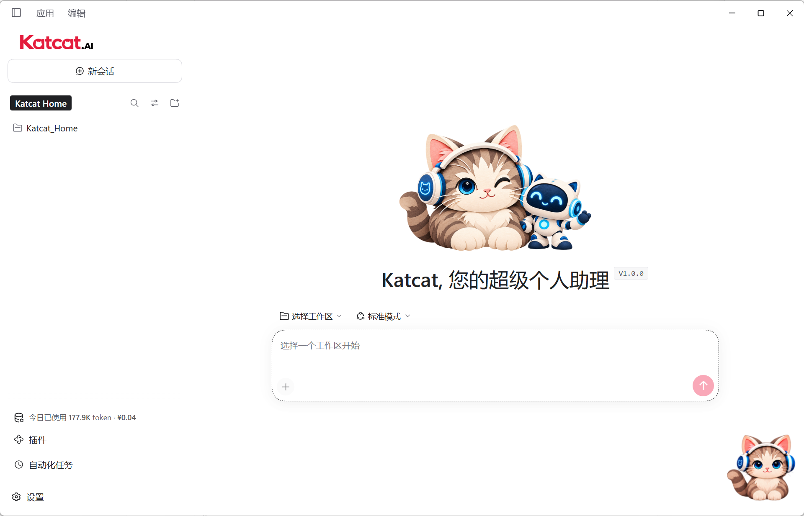
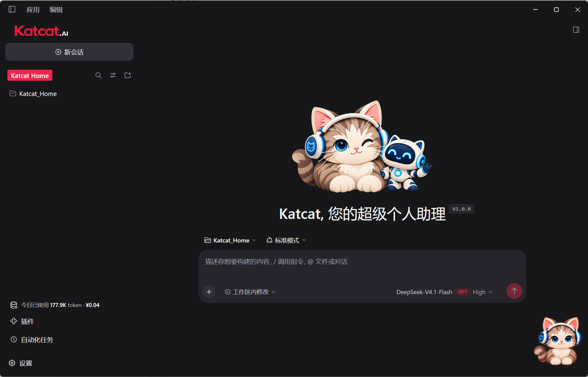

# Katcat.AI

[English](README.md) | 中文

**Katcat，您的超级个人助理。**

Katcat.AI 是基于 **DeepSeek Harness（DSH-0.2.1-rc.2）** 二次开发的 Windows 桌面智能体，将文档处理、表格分析、数据可视化、内容创作、远程连接和自动化能力整合进桌面界面，还有一只陪你工作的小猫。

[下载 Windows 版](https://www.sudotech.ai/katcat.html) · [使用指南](https://www.sudotech.ai/katcat-guide.html) · [反馈问题](https://github.com/yyshi801207-sketch/Katcat.AI/issues/new/choose) · [参与贡献](CONTRIBUTING.zh.md)



## 可以用来做什么

- **处理手边的材料：** 阅读文档、整理信息、分析表格、起草报告。
- **把想法做出来：** 研究一个主题、创作内容，或将数据变成可视化作品。
- **串联多个步骤：** 使用 Harness 工具和 Katcat 办公扩展，处理浏览器操作、远程连接和多步骤任务。
- **打造自己的工作空间：** 切换浅色或深色界面，在 Katcat Home 整理项目，开启桌面小猫。

Katcat 在 DSH 上增加了面向办公场景的产品层。实际效果取决于模型、工具、权限和任务；本仓库不声称具备经过基准测试证实的竞品优势。扩展细节见[产品子系统文档](docs/subsystems/xiaojing.zh.md)。

<a id="run"></a>

## 开始使用

### 安装桌面应用

1. 从[产品页面](https://www.sudotech.ai/katcat.html)下载 Windows x64 安装包，目前面向 Windows 10 / 11。
2. 安装并打开 Katcat.AI。首次使用时，点击**开始使用**进入 API Key 配置，也可以选择稍后配置。
3. 登录 [DeepSeek 开放平台](https://platform.deepseek.com/)，在 [API keys 页面](https://platform.deepseek.com/api_keys)创建密钥。
4. 在 Katcat 中保存密钥。如果跳过了引导，可以进入**设置 → 模型**配置。
5. 选择工作区和已配置的模型，描述你想做的事情。

软件免费分享，模型 API 调用由服务商单独计费。请妥善保管 API Key。完整操作步骤见图文版[使用指南](https://www.sudotech.ai/katcat-guide.html)。

### 试着交给它一个任务

> 阅读这个工作区里的文档，总结要点，再帮我起草一份演示文稿大纲。修改原文件前先问我。

> 分析这份表格，解释数据随时间的变化，并制作一张图表展示你的发现。

> 帮我把这个想法变成具体计划。先告诉我还需要提供哪些信息。

<a id="run-from-source"></a>

### 从源码运行

使用 Node.js 24，以及 `package.json` 中固定的 pnpm 版本。[开发指南](docs/development.zh.md)和[原生构建指南](native/README.zh.md)说明了各平台工具链及支持的 Node 版本。执行真实 AI 任务需要模型密钥，无密钥测试不需要。

```sh
git clone https://github.com/yyshi801207-sketch/Katcat.AI.git
cd Katcat.AI
corepack enable
pnpm install --frozen-lockfile
pnpm run dev:desktop
```

桌面启动器会先构建 Katcat 配置并准备运行时，再打开 Electron，首次启动需要一些时间。成功构建后，`pnpm run start:desktop` 可以复用已有产物。内部包名和配置名仍包含 `xiaojing` 和 `@deepseek-ai/dsh-*`；它们是实现标识，不是另一个下载产品，也不表示本项目属于 DeepSeek 官方。

## 界面预览



这些 Windows 截图仅展示界面，不代表模型准确率、运行速度或典型 API 费用。

## 平台与打包

| 平台 | 状态 |
| --- | --- |
| Windows 10 / 11，x64 | 产品页面提供安装包 |
| macOS，Apple Silicon / Intel | 保留上游打包脚本；Katcat 专用构建和安装尚未验证 |
| Linux | 包含 Harness 源码和工具；此处不提供 Katcat 桌面安装包 |

需要 Windows 开发测试安装包时，在 Windows 上运行：

```sh
pnpm run package:desktop:win:x64:unsigned
```

该命令生成未签名测试构建，不是已签名发行版。输出目录、签名和宿主机要求见[桌面打包文档](apps/desktop/packaging/README.zh.md)。继承的 macOS 命令需要 Mac 构建主机；上传仓库本身不会产生经过验证的 Mac 发行版。

## 开发与贡献

请先阅读[贡献指南](CONTRIBUTING.zh.md)、[架构文档](docs/architecture.zh.md)和[测试说明](docs/testing.zh.md)。Katcat 使用上游的插件架构，开发时需保留许可声明及持久化兼容规则。

| 路径 | 用途 |
| --- | --- |
| `apps/desktop/` | Electron 应用、安装程序、启动页和桌面宠物 |
| `apps/web/` | 浏览器前端及共享资源 |
| `packages/client/xiaojing-product/` | Katcat 品牌、首次使用引导和产品界面 |
| `packages/xiaojing/` | 办公工具及产品扩展 |
| `docs/` | 架构、配置、开发和用户文档 |
| `vendor/` | 固定版本的第三方源码，包含独立的许可及更新规则 |

[Katcat CI](.github/workflows/katcat-ci.yml) 使用 GitHub 托管运行器，执行文档检查、lint、Katcat 构建和针对产品的无密钥测试。继承的上游工作流保留基础设施配置，仅在上游仓库运行。CI 不验证签名安装、真实模型效果或 macOS 可用性。

## 社区与支持

- 通过 [Issues](https://github.com/yyshi801207-sketch/Katcat.AI/issues/new/choose)反馈问题或提出改进建议。
- 分享日志和截图前，请阅读[支持说明](SUPPORT.md)。
- 敏感漏洞请参照[安全报告说明](SECURITY.md)，授予工具权限前请阅读[安全使用提示](SAFETY.zh.md)。
- 参与时请遵守[行为准则](CODE_OF_CONDUCT.md)。
- 产品变化及优先事项见[更新记录](CHANGELOG.md)和[路线图](ROADMAP.md)。

## 致谢与许可证

Katcat.AI 是基于 [DeepSeek Harness](https://github.com/deepseek-ai/deepseek-harness) DSH-0.2.1-rc.2 的独立衍生项目。Harness 提供智能体运行时和由 [Cordis](https://github.com/cordiverse/cordis) 驱动的插件架构；Katcat 增加桌面体验和办公场景增强。本项目不是 DeepSeek 官方产品。

源码按 [MIT License](LICENSE) 分发，保留上游版权声明。第三方依赖继续适用各自的许可证，详见 [THIRD_PARTY_NOTICES.md](THIRD_PARTY_NOTICES.md) 和[第三方源码声明](vendor/README.md)。仓库保留了上游的[品牌使用规范](BRAND_GUIDELINES.zh.md)。
